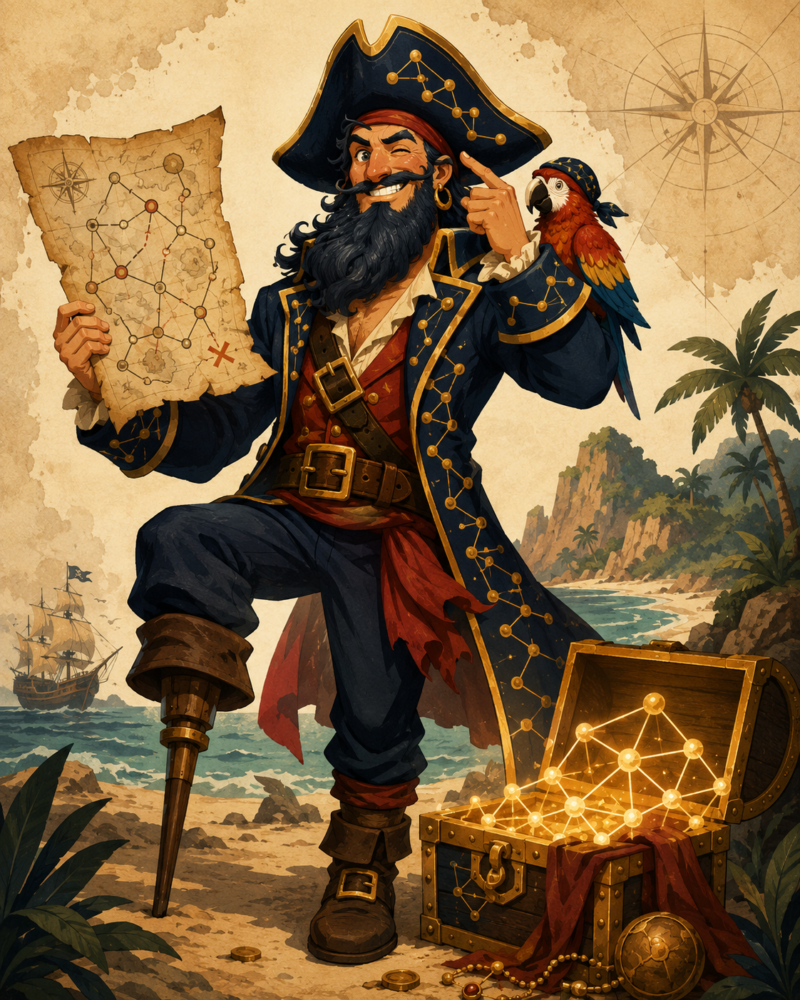

# Long John SPARQL and the Secret of Data Island 🏝️

Long John SPARQL had no compass, no crew, and no patience for opaque query interfaces. What he had was an ontology, a browser full of questions, and LODEON.



/// caption
Torsten Schrade, Long John SPARQL and the Secret of Data Island, ChatGPT, CC BY 4.0
///

<section class="tile lodeon-story-metadata" aria-label="Captain's Log">
<dl>
<dt><strong>Author:</strong></dt>
<dd><strong>Torsten Schrade</strong>, <span class="lodeon-story-metadata-affiliation">Academy of Sciences and Literature | Mainz</span>, <a href="https://orcid.org/0000-0002-0953-2818">https://orcid.org/0000-0002-0953-2818</a></dd>
<dt><strong>Description:</strong></dt>
<dd>A playful LODEON showcase story in which Long John SPARQL journeys through the Culture Knowledge Graph, using local media, SPARQL evidence, visualizations, embeds, IIIF images, metadata, and publication workflows.</dd>
<dt><strong>Keywords:</strong></dt>
<dd>Culture Knowledge Graph, AI-assisted exploration, data story, SPARQL, IIIF</dd>
<dt><strong>Language:</strong></dt>
<dd>en</dd>
<dt><strong>License:</strong></dt>
<dd>CC BY 4.0</dd>
<dt><strong>Publishing date:</strong></dt>
<dd>2026-07-16</dd>
<dt><strong>Download:</strong></dt>
<dd><a href="/story/secret-of-data-island/secret-of-data-island.lodeon.zip">secret-of-data-island.lodeon.zip</a></dd>
</dl>
</section>

To find the data treasure, Long John must solve seven tasks with the Culture Knowledge Graph and record every clue as inspectable evidence.

## Task 1: The Tavern Song

At the harbour tavern, the first clue is sung rather than spoken: “Whisky for my Johnny–A-Dur”. The crew checks the RISM source in the Culture Knowledge Graph instead of trusting a sea shanty by ear.

```shmarql {title="Musicological Data Portals" kg="culture-kg"}
PREFIX rdf: <http://www.w3.org/1999/02/22-rdf-syntax-ns#>
PREFIX rdfs: <http://www.w3.org/2000/01/rdf-schema#>
SELECT DISTINCT ?DataPortal ?DataPortal_label WHERE {
  ?DataPortal rdf:type <https://nfdi.fiz-karlsruhe.de/ontology/NFDI_0000123>.
  OPTIONAL { ?DataPortal rdfs:label ?DataPortal_label. }
  ?DataPortal <https://nfdi.fiz-karlsruhe.de/ontology/NFDI_0000211> <https://nfdi4culture.de/id/E2314>.
}
LIMIT 100
```

```shmarql {title="Task 1: The Tavern Song" kg="culture-kg"}
PREFIX rdfs: <http://www.w3.org/2000/01/rdf-schema#>
PREFIX schema: <http://schema.org/>

SELECT DISTINCT ?source ?label ?description
WHERE {
  VALUES ?source { <https://rism.online/sources/1001344126> }
  OPTIONAL { ?source rdfs:label ?rdfsLabel }
  OPTIONAL { ?source schema:name ?schemaName }
  OPTIONAL { ?source schema:description ?description }
  BIND(COALESCE(?rdfsLabel, ?schemaName, STR(?source)) AS ?label)
}
```

```shmarql {title="Query" kg="culture-kg"}
PREFIX rdf: <http://www.w3.org/1999/02/22-rdf-syntax-ns#>
PREFIX rdfs: <http://www.w3.org/2000/01/rdf-schema#>
SELECT DISTINCT ?Organization ?Organization_label WHERE {
  ?Organization rdf:type <https://nfdi.fiz-karlsruhe.de/ontology/NFDI_0000003>.
  OPTIONAL { ?Organization rdfs:label ?Organization_label. }
  ?Organization <https://nfdi.fiz-karlsruhe.de/ontology/NFDI_0000211> <https://nfdi4culture.de/id/E2313>.
}
LIMIT 100
```

## Task 2: The Ports of Data

A pirate cannot sail without ports. Long John asks which subject areas have data portals and turns the result into a chart. The sea of cultural data suddenly has harbours.

```lodeon-visualization {title="Task 2: The Ports of Knowledge"}
{
  "version": 2,
  "renderer": "plotly",
  "sourceMode": "sparql",
  "source": "PREFIX nfdicore: <https://nfdi.fiz-karlsruhe.de/ontology/>\nPREFIX rdfs: <http://www.w3.org/2000/01/rdf-schema#>\nPREFIX schema: <http://schema.org/>\n\nSELECT ?subjectAreaLabel (COUNT(DISTINCT ?portal) AS ?portalCount)\nWHERE {\n  ?portal a nfdicore:NFDI_0000123 ;\n          nfdicore:NFDI_0000211 ?subjectArea .\n  OPTIONAL { ?subjectArea rdfs:label ?subjectAreaRdfsLabel }\n  OPTIONAL { ?subjectArea schema:name ?subjectAreaName }\n  BIND(COALESCE(?subjectAreaRdfsLabel, ?subjectAreaName, STR(?subjectArea)) AS ?subjectAreaLabel)\n}\nGROUP BY ?subjectAreaLabel\nORDER BY DESC(?portalCount)",
  "url": "",
  "urlFormat": "csv",
  "chartType": "bar",
  "mapping": {
    "x": "subjectAreaLabel",
    "y": "portalCount"
  },
  "plotlyDataJson": "[\n  {\n    \"type\": \"bar\",\n    \"x\": [\n      \"Art History\",\n      \"Architecture\",\n      \"Musicology\",\n      \"Theater Studies\",\n      \"Media Studies\",\n      \"Dance Studies\",\n      \"Digital Humanities\",\n      \"History\",\n      \"Archaelogy\",\n      \"Zoology\",\n      \"Sociocultural Anthropology\",\n      \"Computer Science\",\n      \"German Studies\",\n      \"Botany\",\n      \"Linguistics\",\n      \"Mineralogy\",\n      \"Film Studies\",\n      \"Book Studies\",\n      \"Sinology\",\n      \"Postcolonial Studies\",\n      \"Political Science\",\n      \"Cultural Studies\",\n      \"Literary Studies\",\n      \"Library Science\",\n      \"Jewish Studies\",\n      \"Islamic Studies\",\n      \"Geography\",\n      \"Graphic Design\"\n    ],\n    \"y\": [\n      59,\n      40,\n      31,\n      16,\n      16,\n      14,\n      12,\n      10,\n      4,\n      3,\n      3,\n      3,\n      3,\n      2,\n      2,\n      2,\n      1,\n      1,\n      1,\n      1,\n      1,\n      1,\n      1,\n      1,\n      1,\n      1,\n      1,\n      1\n    ],\n    \"marker\": {\n      \"color\": \"#0072B2\"\n    }\n  }\n]\n",
  "layoutJson": "{\n  \"autosize\": true,\n  \"paper_bgcolor\": \"#ffffff\",\n  \"plot_bgcolor\": \"#ffffff\",\n  \"font\": {\n    \"family\": \"Inter, system-ui, sans-serif\",\n    \"color\": \"#1f2328\"\n  },\n  \"colorway\": [\n    \"#000000\",\n    \"#E69F00\",\n    \"#56B4E9\",\n    \"#009E73\",\n    \"#F0E442\",\n    \"#0072B2\",\n    \"#D55E00\",\n    \"#CC79A7\"\n  ],\n  \"margin\": {\n    \"l\": 56,\n    \"r\": 32,\n    \"t\": 48,\n    \"b\": 64\n  },\n  \"showlegend\": false,\n  \"xaxis\": {\n    \"automargin\": true,\n    \"gridcolor\": \"#e6e6e6\",\n    \"zerolinecolor\": \"#d6d6d6\"\n  },\n  \"yaxis\": {\n    \"automargin\": true,\n    \"gridcolor\": \"#e6e6e6\",\n    \"zerolinecolor\": \"#d6d6d6\"\n  }\n}\n",
  "configJson": "{\n  \"responsive\": true,\n  \"displaylogo\": false,\n  \"scrollZoom\": false\n}\n",
  "data": {
    "columns": [
      {
        "name": "subjectAreaLabel",
        "type": "string"
      },
      {
        "name": "portalCount",
        "type": "number"
      }
    ],
    "rows": [
      {
        "subjectAreaLabel": "Art History",
        "portalCount": 59
      },
      {
        "subjectAreaLabel": "Architecture",
        "portalCount": 40
      },
      {
        "subjectAreaLabel": "Musicology",
        "portalCount": 31
      },
      {
        "subjectAreaLabel": "Theater Studies",
        "portalCount": 16
      },
      {
        "subjectAreaLabel": "Media Studies",
        "portalCount": 16
      },
      {
        "subjectAreaLabel": "Dance Studies",
        "portalCount": 14
      },
      {
        "subjectAreaLabel": "Digital Humanities",
        "portalCount": 12
      },
      {
        "subjectAreaLabel": "History",
        "portalCount": 10
      },
      {
        "subjectAreaLabel": "Archaelogy",
        "portalCount": 4
      },
      {
        "subjectAreaLabel": "Zoology",
        "portalCount": 3
      },
      {
        "subjectAreaLabel": "Sociocultural Anthropology",
        "portalCount": 3
      },
      {
        "subjectAreaLabel": "Computer Science",
        "portalCount": 3
      },
      {
        "subjectAreaLabel": "German Studies",
        "portalCount": 3
      },
      {
        "subjectAreaLabel": "Botany",
        "portalCount": 2
      },
      {
        "subjectAreaLabel": "Linguistics",
        "portalCount": 2
      },
      {
        "subjectAreaLabel": "Mineralogy",
        "portalCount": 2
      },
      {
        "subjectAreaLabel": "Film Studies",
        "portalCount": 1
      },
      {
        "subjectAreaLabel": "Book Studies",
        "portalCount": 1
      },
      {
        "subjectAreaLabel": "Sinology",
        "portalCount": 1
      },
      {
        "subjectAreaLabel": "Postcolonial Studies",
        "portalCount": 1
      },
      {
        "subjectAreaLabel": "Political Science",
        "portalCount": 1
      },
      {
        "subjectAreaLabel": "Cultural Studies",
        "portalCount": 1
      },
      {
        "subjectAreaLabel": "Literary Studies",
        "portalCount": 1
      },
      {
        "subjectAreaLabel": "Library Science",
        "portalCount": 1
      },
      {
        "subjectAreaLabel": "Jewish Studies",
        "portalCount": 1
      },
      {
        "subjectAreaLabel": "Islamic Studies",
        "portalCount": 1
      },
      {
        "subjectAreaLabel": "Geography",
        "portalCount": 1
      },
      {
        "subjectAreaLabel": "Graphic Design",
        "portalCount": 1
      }
    ]
  },
  "figure": {
    "data": [
      {
        "type": "bar",
        "x": [
          "Art History",
          "Architecture",
          "Musicology",
          "Theater Studies",
          "Media Studies",
          "Dance Studies",
          "Digital Humanities",
          "History",
          "Archaelogy",
          "Zoology",
          "Sociocultural Anthropology",
          "Computer Science",
          "German Studies",
          "Botany",
          "Linguistics",
          "Mineralogy",
          "Film Studies",
          "Book Studies",
          "Sinology",
          "Postcolonial Studies",
          "Political Science",
          "Cultural Studies",
          "Literary Studies",
          "Library Science",
          "Jewish Studies",
          "Islamic Studies",
          "Geography",
          "Graphic Design"
        ],
        "y": [
          59,
          40,
          31,
          16,
          16,
          14,
          12,
          10,
          4,
          3,
          3,
          3,
          3,
          2,
          2,
          2,
          1,
          1,
          1,
          1,
          1,
          1,
          1,
          1,
          1,
          1,
          1,
          1
        ],
        "marker": {
          "color": "#0072B2"
        }
      }
    ],
    "layout": {
      "autosize": true,
      "paper_bgcolor": "#ffffff",
      "plot_bgcolor": "#ffffff",
      "font": {
        "family": "Inter, system-ui, sans-serif",
        "color": "#1f2328"
      },
      "colorway": [
        "#000000",
        "#E69F00",
        "#56B4E9",
        "#009E73",
        "#F0E442",
        "#0072B2",
        "#D55E00",
        "#CC79A7"
      ],
      "margin": {
        "l": 56,
        "r": 32,
        "t": 48,
        "b": 64
      },
      "showlegend": false,
      "xaxis": {
        "automargin": true,
        "gridcolor": "#e6e6e6",
        "zerolinecolor": "#d6d6d6"
      },
      "yaxis": {
        "automargin": true,
        "gridcolor": "#e6e6e6",
        "zerolinecolor": "#d6d6d6"
      }
    },
    "config": {
      "responsive": true,
      "displaylogo": false,
      "scrollZoom": false
    }
  }
}
```

## Task 3: The Crew

The map is useless without a crew. This visualization counts the kinds of institutions behind the data and shows who is helping to keep the treasure afloat.

```shmarql {title="Query" kg="culture-kg"}
PREFIX org: <http://www.w3.org/ns/org#>
PREFIX rdfs: <http://www.w3.org/2000/01/rdf-schema#>
PREFIX schema: <http://schema.org/>

SELECT ?classificationLabel (COUNT(DISTINCT ?inst) AS ?count)
WHERE {
  ?inst a ?orgClass .
  ?inst org:classification ?classification .
  OPTIONAL { ?classification rdfs:label ?rdfsLabel }
  OPTIONAL { ?classification schema:name ?schemaName }
  BIND(COALESCE(?rdfsLabel, ?schemaName, STR(?classification)) AS ?classificationLabel)
}
GROUP BY ?classificationLabel
ORDER BY DESC(?count)
```

```lodeon-rawgraphs {title="Task 3: The Crew Registry"}
{
  "version": 1,
  "renderer": "rawgraphs",
  "project": "{\"version\":\"1.2\",\"userInput\":[{\"classificationLabel\":\"University\",\"count\":\"31\"},{\"classificationLabel\":\"Research Institute\",\"count\":\"26\"},{\"classificationLabel\":\"Association\",\"count\":\"24\"},{\"classificationLabel\":\"Library\",\"count\":\"17\"},{\"classificationLabel\":\"Research Centre\",\"count\":\"16\"},{\"classificationLabel\":\"Academic Association\",\"count\":\"15\"},{\"classificationLabel\":\"Prussian Cultural Heritage Foundation\",\"count\":\"10\"},{\"classificationLabel\":\"Museum\",\"count\":\"10\"},{\"classificationLabel\":\"Working Group\",\"count\":\"8\"},{\"classificationLabel\":\"Archive\",\"count\":\"8\"},{\"classificationLabel\":\"Leibniz Association\",\"count\":\"7\"},{\"classificationLabel\":\"Specialised Information Service\",\"count\":\"7\"},{\"classificationLabel\":\"University of Applied Sciences\",\"count\":\"5\"},{\"classificationLabel\":\"Collection\",\"count\":\"4\"},{\"classificationLabel\":\"Research Laboratory\",\"count\":\"4\"},{\"classificationLabel\":\"Academy of Science\",\"count\":\"4\"},{\"classificationLabel\":\"Max Planck Institute\",\"count\":\"3\"},{\"classificationLabel\":\"Max Weber Foundation\",\"count\":\"3\"},{\"classificationLabel\":\"Public Institution\",\"count\":\"3\"},{\"classificationLabel\":\"Fraunhofer Institute\",\"count\":\"2\"},{\"classificationLabel\":\"Klassik Stiftung Weimar\",\"count\":\"1\"},{\"classificationLabel\":\"Registered Corporate Society\",\"count\":\"1\"}],\"userInputFormat\":\"sparql\",\"dataSource\":{\"type\":\"sparql\",\"url\":\"https://nfdi4culture.de/qlever\",\"query\":{\"queryType\":\"SELECT\",\"variables\":[{\"termType\":\"Variable\",\"value\":\"classificationLabel\"},{\"expression\":{\"expression\":{\"termType\":\"Variable\",\"value\":\"inst\"},\"type\":\"aggregate\",\"aggregation\":\"count\",\"distinct\":true},\"variable\":{\"termType\":\"Variable\",\"value\":\"count\"}}],\"where\":[{\"type\":\"bgp\",\"triples\":[{\"subject\":{\"termType\":\"Variable\",\"value\":\"inst\"},\"predicate\":{\"termType\":\"NamedNode\",\"value\":\"http://www.w3.org/1999/02/22-rdf-syntax-ns#type\"},\"object\":{\"termType\":\"Variable\",\"value\":\"orgClass\"}},{\"subject\":{\"termType\":\"Variable\",\"value\":\"inst\"},\"predicate\":{\"termType\":\"NamedNode\",\"value\":\"http://www.w3.org/ns/org#classification\"},\"object\":{\"termType\":\"Variable\",\"value\":\"classification\"}}]},{\"type\":\"optional\",\"patterns\":[{\"type\":\"bgp\",\"triples\":[{\"subject\":{\"termType\":\"Variable\",\"value\":\"classification\"},\"predicate\":{\"termType\":\"NamedNode\",\"value\":\"http://www.w3.org/2000/01/rdf-schema#label\"},\"object\":{\"termType\":\"Variable\",\"value\":\"rdfsLabel\"}}]}]},{\"type\":\"optional\",\"patterns\":[{\"type\":\"bgp\",\"triples\":[{\"subject\":{\"termType\":\"Variable\",\"value\":\"classification\"},\"predicate\":{\"termType\":\"NamedNode\",\"value\":\"http://schema.org/name\"},\"object\":{\"termType\":\"Variable\",\"value\":\"schemaName\"}}]}]},{\"type\":\"bind\",\"variable\":{\"termType\":\"Variable\",\"value\":\"classificationLabel\"},\"expression\":{\"type\":\"operation\",\"operator\":\"coalesce\",\"args\":[{\"termType\":\"Variable\",\"value\":\"rdfsLabel\"},{\"termType\":\"Variable\",\"value\":\"schemaName\"},{\"type\":\"operation\",\"operator\":\"str\",\"args\":[{\"termType\":\"Variable\",\"value\":\"classification\"}]}]}}],\"group\":[{\"expression\":{\"termType\":\"Variable\",\"value\":\"classificationLabel\"}}],\"order\":[{\"expression\":{\"termType\":\"Variable\",\"value\":\"count\"},\"descending\":true}],\"type\":\"query\",\"prefixes\":{\"org\":\"http://www.w3.org/ns/org#\",\"rdfs\":\"http://www.w3.org/2000/01/rdf-schema#\",\"schema\":\"http://schema.org/\"}}},\"rawData\":[[\"University\",\"31\"],[\"Research Institute\",\"26\"],[\"Association\",\"24\"],[\"Library\",\"17\"],[\"Research Centre\",\"16\"],[\"Academic Association\",\"15\"],[\"Prussian Cultural Heritage Foundation\",\"10\"],[\"Museum\",\"10\"],[\"Working Group\",\"8\"],[\"Archive\",\"8\"],[\"Leibniz Association\",\"7\"],[\"Specialised Information Service\",\"7\"],[\"University of Applied Sciences\",\"5\"],[\"Collection\",\"4\"],[\"Research Laboratory\",\"4\"],[\"Academy of Science\",\"4\"],[\"Max Planck Institute\",\"3\"],[\"Max Weber Foundation\",\"3\"],[\"Public Institution\",\"3\"],[\"Fraunhofer Institute\",\"2\"],[\"Klassik Stiftung Weimar\",\"1\"],[\"Registered Corporate Society\",\"1\"]],\"parseError\":null,\"parseOptions\":{\"separator\":\",\",\"thousandsSeparator\":\",\",\"decimalsSeparator\":\".\",\"locale\":\"de\",\"unstackedData\":null,\"unstackedColumns\":null},\"dataTypes\":{\"classificationLabel\":\"string\",\"count\":{\"type\":\"number\",\"locale\":\"de\",\"decimal\":\".\",\"group\":\",\",\"numerals\":[\"0\",\"1\",\"2\",\"3\",\"4\",\"5\",\"6\",\"7\",\"8\",\"9\"]}},\"chart\":\"rawgraphs.voronoitreemap\",\"mapping\":{\"size\":{\"ids\":[\"4\"],\"value\":[\"count\"],\"isValid\":true,\"mappedType\":\"number\",\"config\":{\"aggregation\":[\"sum\"]}},\"hierarchy\":{\"ids\":[\"5\"],\"value\":[\"classificationLabel\"],\"isValid\":true,\"mappedType\":\"string\"},\"label\":{\"ids\":[\"6\",\"7\"],\"value\":[\"classificationLabel\",\"count\"],\"isValid\":true,\"mappedType\":\"number\",\"config\":{\"aggregation\":[\"csvDistinct\",\"csvDistinct\"]}},\"color\":{\"ids\":[\"8\"],\"value\":[\"classificationLabel\"],\"isValid\":true,\"mappedType\":\"string\",\"config\":{\"aggregation\":[\"csvDistinct\"]}}},\"visualOptions\":{\"width\":805,\"height\":600,\"background\":\"#FFFFFF\",\"marginTop\":10,\"marginRight\":10,\"marginBottom\":10,\"marginLeft\":10,\"showLegend\":false,\"legendWidth\":200,\"seed\":0,\"padding\":2,\"clipToPolygon\":true,\"edges\":6,\"rotation\":0,\"isRegular\":true,\"colorScale\":{\"scaleType\":\"ordinal\",\"interpolator\":\"interpolateSpectral\",\"userScaleValues\":[{\"range\":\"#9e0142\",\"domain\":\"Academic Association\"},{\"range\":\"#b81e48\",\"domain\":\"Academy of Science\"},{\"range\":\"#cf394b\",\"domain\":\"Archive\"},{\"range\":\"#e1524a\",\"domain\":\"Association\"},{\"range\":\"#ee6b49\",\"domain\":\"Collection\"},{\"range\":\"#f68650\",\"domain\":\"Fraunhofer Institute\"},{\"range\":\"#fba35e\",\"domain\":\"Klassik Stiftung Weimar\"},{\"range\":\"#fdbe70\",\"domain\":\"Leibniz Association\"},{\"range\":\"#fed584\",\"domain\":\"Library\"},{\"range\":\"#fee89a\",\"domain\":\"Max Planck Institute\"},{\"range\":\"#fdf5ac\",\"domain\":\"Max Weber Foundation\"},{\"range\":\"#f7faaf\",\"domain\":\"Museum\"},{\"range\":\"#ebf7a6\",\"domain\":\"Prussian Cultural Heritage Foundation\"},{\"range\":\"#d8ef9f\",\"domain\":\"Public Institution\"},{\"range\":\"#bee5a0\",\"domain\":\"Registered Corporate Society\"},{\"range\":\"#a0d9a3\",\"domain\":\"Research Centre\"},{\"range\":\"#81cba5\",\"domain\":\"Research Institute\"},{\"range\":\"#63b9aa\",\"domain\":\"Research Laboratory\"},{\"range\":\"#4ba0b1\",\"domain\":\"Specialised Information Service\"},{\"range\":\"#4285b4\",\"domain\":\"University\"},{\"range\":\"#4b6aae\",\"domain\":\"University of Applied Sciences\"},{\"range\":\"#5e4fa2\",\"domain\":\"Working Group\"}],\"defaultColor\":\"#cccccc\"},\"labelStyles\":[],\"showLabelsOutline\":false},\"customChart\":null}",
  "svg": "<svg width=\"805\" height=\"600\"><rect width=\"805\" height=\"600\" x=\"0\" y=\"0\" fill=\"#FFFFFF\" id=\"background\"></rect><g id=\"viz\" transform=\"translate(402.5,300)\"><g id=\"cells\"><path d=\"M86.156,290L167.432,290L245.977,153.956L222.697,94.435L211.192,81.847L134.662,49.784L73.716,53.009L52.648,61.194L-2.974,173.853L18.46,231.713z\" fill=\"rgb(66, 133, 180)\" stroke=\"#FFFFFF\" stroke-width=\"2\" id=\"University\"></path><path d=\"M-65.74,-102.079L-66.295,-20.373L-30.974,34.176L52.648,61.194L73.716,53.009L131.906,1.426L132.435,0.542L139.84,-88.203L67.943,-160.313L-3.502,-166.12L-50.43,-133.611z\" fill=\"rgb(129, 203, 165)\" stroke=\"#FFFFFF\" stroke-width=\"2\" id=\"Research Institute\"></path><path d=\"M-71.52,67.863L-143.974,10.881L-244.243,46.524L-278.255,98.048L-199.886,233.787L-125.014,226.764L-58.174,159.161z\" fill=\"rgb(225, 82, 74)\" stroke=\"#FFFFFF\" stroke-width=\"2\" id=\"Association\"></path><path d=\"M-157.434,-115.324L-252.569,-142.537L-324.703,-17.598L-244.243,46.524L-143.974,10.881L-139.866,2.305L-148.603,-102.019z\" fill=\"rgb(254, 213, 132)\" stroke=\"#FFFFFF\" stroke-width=\"2\" id=\"Library\"></path><path d=\"M167.432,-290L132.023,-290L67.943,-160.313L139.84,-88.203L191.345,-92.31L253.236,-141.382z\" fill=\"rgb(160, 217, 163)\" stroke=\"#FFFFFF\" stroke-width=\"2\" id=\"Research Centre\"></path><path d=\"M-167.432,-290L-177.505,-272.553L-129.391,-153.774L-50.43,-133.611L-3.502,-166.12L-15.823,-290z\" fill=\"rgb(158, 1, 66)\" stroke=\"#FFFFFF\" stroke-width=\"2\" id=\"Academic Association\"></path><path d=\"M132.023,-290L-15.823,-290L-3.502,-166.12L67.943,-160.313z\" fill=\"rgb(235, 247, 166)\" stroke=\"#FFFFFF\" stroke-width=\"2\" id=\"Prussian Cultural Heritage Foundation\"></path><path d=\"M-107.729,290L-8.749,290L18.46,231.713L-2.974,173.853L-58.174,159.161L-125.014,226.764z\" fill=\"rgb(247, 250, 175)\" stroke=\"#FFFFFF\" stroke-width=\"2\" id=\"Museum\"></path><path d=\"M-71.52,67.863L-58.174,159.161L-2.974,173.853L52.648,61.194L-30.974,34.176z\" fill=\"rgb(94, 79, 162)\" stroke=\"#FFFFFF\" stroke-width=\"2\" id=\"Working Group\"></path><path d=\"M214.58,-8.435L211.192,81.847L222.697,94.435L273.852,105.675L334.863,0L319.011,-27.457L215.044,-9.011z\" fill=\"rgb(207, 57, 75)\" stroke=\"#FFFFFF\" stroke-width=\"2\" id=\"Archive\"></path><path d=\"M-252.569,-142.537L-157.434,-115.324L-129.391,-153.774L-177.505,-272.553z\" fill=\"rgb(253, 190, 112)\" stroke=\"#FFFFFF\" stroke-width=\"2\" id=\"Leibniz Association\"></path><path d=\"M319.011,-27.457L253.236,-141.382L191.345,-92.31L215.044,-9.011z\" fill=\"rgb(75, 160, 177)\" stroke=\"#FFFFFF\" stroke-width=\"2\" id=\"Specialised Information Service\"></path><path d=\"M-65.74,-102.079L-148.603,-102.019L-139.866,2.305L-66.295,-20.373z\" fill=\"rgb(75, 106, 174)\" stroke=\"#FFFFFF\" stroke-width=\"2\" id=\"University of Applied Sciences\"></path><path d=\"M214.58,-8.435L132.435,0.542L131.906,1.426L134.662,49.784L211.192,81.847z\" fill=\"rgb(238, 107, 73)\" stroke=\"#FFFFFF\" stroke-width=\"2\" id=\"Collection\"></path><path d=\"M214.58,-8.435L215.044,-9.011L191.345,-92.31L139.84,-88.203L132.435,0.542z\" fill=\"rgb(99, 185, 170)\" stroke=\"#FFFFFF\" stroke-width=\"2\" id=\"Research Laboratory\"></path><path d=\"M-71.52,67.863L-30.974,34.176L-66.295,-20.373L-139.866,2.305L-143.974,10.881z\" fill=\"rgb(184, 30, 72)\" stroke=\"#FFFFFF\" stroke-width=\"2\" id=\"Academy of Science\"></path><path d=\"M-324.703,-17.598L-334.863,0L-278.255,98.048L-244.243,46.524z\" fill=\"rgb(254, 232, 154)\" stroke=\"#FFFFFF\" stroke-width=\"2\" id=\"Max Planck Institute\"></path><path d=\"M-167.432,290L-107.729,290L-125.014,226.764L-199.886,233.787z\" fill=\"rgb(253, 245, 172)\" stroke=\"#FFFFFF\" stroke-width=\"2\" id=\"Max Weber Foundation\"></path><path d=\"M-157.434,-115.324L-148.603,-102.019L-65.74,-102.079L-50.43,-133.611L-129.391,-153.774z\" fill=\"rgb(216, 239, 159)\" stroke=\"#FFFFFF\" stroke-width=\"2\" id=\"Public Institution\"></path><path d=\"M86.156,290L18.46,231.713L-8.749,290z\" fill=\"rgb(246, 134, 80)\" stroke=\"#FFFFFF\" stroke-width=\"2\" id=\"Fraunhofer Institute\"></path><path d=\"M134.662,49.784L131.906,1.426L73.716,53.009z\" fill=\"rgb(251, 163, 94)\" stroke=\"#FFFFFF\" stroke-width=\"2\" id=\"Klassik Stiftung Weimar\"></path><path d=\"M245.977,153.956L273.852,105.675L222.697,94.435z\" fill=\"rgb(190, 229, 160)\" stroke=\"#FFFFFF\" stroke-width=\"2\" id=\"Registered Corporate Society\"></path><path d=\"M167.432,-290L-167.432,-290L-334.863,0L-167.432,290L167.432,290L334.863,0z\" fill=\"none\" stroke=\"#FFFFFF\" stroke-width=\"4\"></path></g><g id=\"labels\"><text text-anchor=\"middle\" dominant-baseline=\"text-before-edge\" transform=\"translate(119.39355230887652,156.46064136336804)\"><tspan x=\"3\" y=\"0.2em\" style=\"font-family: Arial, sans-serif; font-size: 10px; fill: black; font-weight: bold;\">University</tspan><tspan x=\"3\" y=\"1.3em\" style=\"font-family: Arial, sans-serif; font-size: 10px; fill: black; font-weight: normal;\">31</tspan></text><text text-anchor=\"middle\" dominant-baseline=\"text-before-edge\" transform=\"translate(32.79609192915812,-66.42780719771298)\"><tspan x=\"3\" y=\"0.2em\" style=\"font-family: Arial, sans-serif; font-size: 10px; fill: black; font-weight: bold;\">Research Institute</tspan><tspan x=\"3\" y=\"1.3em\" style=\"font-family: Arial, sans-serif; font-size: 10px; fill: black; font-weight: normal;\">26</tspan></text><text text-anchor=\"middle\" dominant-baseline=\"text-before-edge\" transform=\"translate(-163.36406465231096,110.2606201394626)\"><tspan x=\"3\" y=\"0.2em\" style=\"font-family: Arial, sans-serif; font-size: 10px; fill: black; font-weight: bold;\">Association</tspan><tspan x=\"3\" y=\"1.3em\" style=\"font-family: Arial, sans-serif; font-size: 10px; fill: black; font-weight: normal;\">24</tspan></text><text text-anchor=\"middle\" dominant-baseline=\"text-before-edge\" transform=\"translate(-223.06584850105165,-57.687079742129775)\"><tspan x=\"3\" y=\"0.2em\" style=\"font-family: Arial, sans-serif; font-size: 10px; fill: black; font-weight: bold;\">Library</tspan><tspan x=\"3\" y=\"1.3em\" style=\"font-family: Arial, sans-serif; font-size: 10px; fill: black; font-weight: normal;\">17</tspan></text><text text-anchor=\"middle\" dominant-baseline=\"text-before-edge\" transform=\"translate(157.70790258272098,-190.9706735106717)\"><tspan x=\"3\" y=\"0.2em\" style=\"font-family: Arial, sans-serif; font-size: 10px; fill: black; font-weight: bold;\">Research Centre</tspan><tspan x=\"3\" y=\"1.3em\" style=\"font-family: Arial, sans-serif; font-size: 10px; fill: black; font-weight: normal;\">16</tspan></text><text text-anchor=\"middle\" dominant-baseline=\"text-before-edge\" transform=\"translate(-82.3164020731641,-232.6030698956348)\"><tspan x=\"3\" y=\"0.2em\" style=\"font-family: Arial, sans-serif; font-size: 10px; fill: black; font-weight: bold;\">Academic Association</tspan><tspan x=\"3\" y=\"1.3em\" style=\"font-family: Arial, sans-serif; font-size: 10px; fill: black; font-weight: normal;\">15</tspan></text><text text-anchor=\"middle\" dominant-baseline=\"text-before-edge\" transform=\"translate(47.35059046162577,-245.49957664696657)\"><tspan x=\"3\" y=\"0.2em\" style=\"font-family: Arial, sans-serif; font-size: 10px; fill: black; font-weight: bold;\">Prussian Cultural Heritage Foundation</tspan><tspan x=\"3\" y=\"1.3em\" style=\"font-family: Arial, sans-serif; font-size: 10px; fill: black; font-weight: normal;\">10</tspan></text><text text-anchor=\"middle\" dominant-baseline=\"text-before-edge\" transform=\"translate(-52.304550441305686,220.0653791349351)\"><tspan x=\"3\" y=\"0.2em\" style=\"font-family: Arial, sans-serif; font-size: 10px; fill: black; font-weight: bold;\">Museum</tspan><tspan x=\"3\" y=\"1.3em\" style=\"font-family: Arial, sans-serif; font-size: 10px; fill: black; font-weight: normal;\">10</tspan></text><text text-anchor=\"middle\" dominant-baseline=\"text-before-edge\" transform=\"translate(-17.39949239659787,88.92371015334615)\"><tspan x=\"3\" y=\"0.2em\" style=\"font-family: Arial, sans-serif; font-size: 10px; fill: black; font-weight: bold;\">Working Group</tspan><tspan x=\"3\" y=\"1.3em\" style=\"font-family: Arial, sans-serif; font-size: 10px; fill: black; font-weight: normal;\">8</tspan></text><text text-anchor=\"middle\" dominant-baseline=\"text-before-edge\" transform=\"translate(265.44344956733835,22.977572689968653)\"><tspan x=\"3\" y=\"0.2em\" style=\"font-family: Arial, sans-serif; font-size: 10px; fill: black; font-weight: bold;\">Archive</tspan><tspan x=\"3\" y=\"1.3em\" style=\"font-family: Arial, sans-serif; font-size: 10px; fill: black; font-weight: normal;\">8</tspan></text><text text-anchor=\"middle\" dominant-baseline=\"text-before-edge\" transform=\"translate(-184.91975103325373,-191.04202884578348)\"><tspan x=\"3\" y=\"0.2em\" style=\"font-family: Arial, sans-serif; font-size: 10px; fill: black; font-weight: bold;\">Leibniz Association</tspan><tspan x=\"3\" y=\"1.3em\" style=\"font-family: Arial, sans-serif; font-size: 10px; fill: black; font-weight: normal;\">7</tspan></text><text text-anchor=\"middle\" dominant-baseline=\"text-before-edge\" transform=\"translate(247.60005171444982,-77.59377470089326)\"><tspan x=\"3\" y=\"0.2em\" style=\"font-family: Arial, sans-serif; font-size: 10px; fill: black; font-weight: bold;\">Specialised Information Service</tspan><tspan x=\"3\" y=\"1.3em\" style=\"font-family: Arial, sans-serif; font-size: 10px; fill: black; font-weight: normal;\">7</tspan></text><text text-anchor=\"middle\" dominant-baseline=\"text-before-edge\" transform=\"translate(-107.32219731268742,-67.38028975207352)\"><tspan x=\"3\" y=\"0.2em\" style=\"font-family: Arial, sans-serif; font-size: 10px; fill: black; font-weight: bold;\">University of Applied Sciences</tspan><tspan x=\"3\" y=\"1.3em\" style=\"font-family: Arial, sans-serif; font-size: 10px; fill: black; font-weight: normal;\">5</tspan></text><text text-anchor=\"middle\" dominant-baseline=\"text-before-edge\" transform=\"translate(176.71207667350185,19.647316079535035)\"><tspan x=\"3\" y=\"0.2em\" style=\"font-family: Arial, sans-serif; font-size: 10px; fill: black; font-weight: bold;\">Collection</tspan><tspan x=\"3\" y=\"1.3em\" style=\"font-family: Arial, sans-serif; font-size: 10px; fill: black; font-weight: normal;\">4</tspan></text><text text-anchor=\"middle\" dominant-baseline=\"text-before-edge\" transform=\"translate(168.54299900237618,-55.101732478001466)\"><tspan x=\"3\" y=\"0.2em\" style=\"font-family: Arial, sans-serif; font-size: 10px; fill: black; font-weight: bold;\">Research Laboratory</tspan><tspan x=\"3\" y=\"1.3em\" style=\"font-family: Arial, sans-serif; font-size: 10px; fill: black; font-weight: normal;\">4</tspan></text><text text-anchor=\"middle\" dominant-baseline=\"text-before-edge\" transform=\"translate(-83.76358205719765,9.047795340261246)\"><tspan x=\"3\" y=\"0.2em\" style=\"font-family: Arial, sans-serif; font-size: 10px; fill: black; font-weight: bold;\">Academy of Science</tspan><tspan x=\"3\" y=\"1.3em\" style=\"font-family: Arial, sans-serif; font-size: 10px; fill: black; font-weight: normal;\">4</tspan></text><text text-anchor=\"middle\" dominant-baseline=\"text-before-edge\" transform=\"translate(-290.18906550805485,26.539877230536526)\"><tspan x=\"3\" y=\"0.2em\" style=\"font-family: Arial, sans-serif; font-size: 10px; fill: black; font-weight: bold;\">Max Planck Institute</tspan><tspan x=\"3\" y=\"1.3em\" style=\"font-family: Arial, sans-serif; font-size: 10px; fill: black; font-weight: normal;\">3</tspan></text><text text-anchor=\"middle\" dominant-baseline=\"text-before-edge\" transform=\"translate(-150.5454494759336,246.91770980138278)\"><tspan x=\"3\" y=\"0.2em\" style=\"font-family: Arial, sans-serif; font-size: 10px; fill: black; font-weight: bold;\">Max Weber Foundation</tspan><tspan x=\"3\" y=\"1.3em\" style=\"font-family: Arial, sans-serif; font-size: 10px; fill: black; font-weight: normal;\">3</tspan></text><text text-anchor=\"middle\" dominant-baseline=\"text-before-edge\" transform=\"translate(-107.37115186659484,-134.48183888290353)\"><tspan x=\"3\" y=\"0.2em\" style=\"font-family: Arial, sans-serif; font-size: 10px; fill: black; font-weight: bold;\">Public Institution</tspan><tspan x=\"3\" y=\"1.3em\" style=\"font-family: Arial, sans-serif; font-size: 10px; fill: black; font-weight: normal;\">3</tspan></text><text text-anchor=\"middle\" dominant-baseline=\"text-before-edge\" transform=\"translate(31.105052952291253,259.00196841615866)\"><tspan x=\"3\" y=\"0.2em\" style=\"font-family: Arial, sans-serif; font-size: 10px; fill: black; font-weight: bold;\">Fraunhofer Institute</tspan><tspan x=\"3\" y=\"1.3em\" style=\"font-family: Arial, sans-serif; font-size: 10px; fill: black; font-weight: normal;\">2</tspan></text><text text-anchor=\"middle\" dominant-baseline=\"text-before-edge\" transform=\"translate(112.34903459610004,23.315711831059005)\"><tspan x=\"3\" y=\"0.2em\" style=\"font-family: Arial, sans-serif; font-size: 10px; fill: black; font-weight: bold;\">Klassik Stiftung Weimar</tspan><tspan x=\"3\" y=\"1.3em\" style=\"font-family: Arial, sans-serif; font-size: 10px; fill: black; font-weight: normal;\">1</tspan></text><text text-anchor=\"middle\" dominant-baseline=\"text-before-edge\" transform=\"translate(247.0891238704784,106.5161016145732)\"><tspan x=\"3\" y=\"0.2em\" style=\"font-family: Arial, sans-serif; font-size: 10px; fill: black; font-weight: bold;\">Registered Corporate Society</tspan><tspan x=\"3\" y=\"1.3em\" style=\"font-family: Arial, sans-serif; font-size: 10px; fill: black; font-weight: normal;\">1</tspan></text></g></g></svg>",
  "summary": {
    "version": "1.2",
    "chartId": "rawgraphs.voronoitreemap",
    "chartName": "Treemap (Voronoi)",
    "rowCount": 22,
    "columnCount": 2
  }
}
```

## Task 4: The Disguise Chest

Before entering the island archive, Long John needs a disguise. The graph points to costume objects, and LODEON turns the results into a remote embed gallery.

```lodeon-embed {title="Task 4: The Disguise Chest"}
{
  "version": 1,
  "renderer": "iframe",
  "url": "https://semantic-kompakkt.de/viewer/index.html?entity=673db4423c1250c11a3303d4&mode=open",
  "urls": [
    "https://semantic-kompakkt.de/viewer/index.html?entity=673db4423c1250c11a3303d4&mode=open",
    "https://semantic-kompakkt.de/viewer/index.html?entity=673db4e43c1250c11a3303d7&mode=open",
    "https://semantic-kompakkt.de/viewer/index.html?entity=673dbabf3c1250c11a3303ea&mode=open",
    "https://semantic-kompakkt.de/viewer/index.html?entity=673dbcbb3c1250c11a3303f9&mode=open"
  ],
  "items": [
    {
      "url": "https://semantic-kompakkt.de/viewer/index.html?entity=673db4423c1250c11a3303d4&mode=open",
      "label": "Wams mit Schlitzen, um 1630 (mit späteren Änderungen)",
      "resource": "https://semantic-kompakkt.de/entity/673db4423c1250c11a3303d4"
    },
    {
      "url": "https://semantic-kompakkt.de/viewer/index.html?entity=673db4e43c1250c11a3303d7&mode=open",
      "label": "Wams mit Schlitzmuster, um 1600/1610",
      "resource": "https://semantic-kompakkt.de/entity/673db4e43c1250c11a3303d7"
    },
    {
      "url": "https://semantic-kompakkt.de/viewer/index.html?entity=673dbabf3c1250c11a3303ea&mode=open",
      "label": "Weste (blau), um 1695",
      "resource": "https://semantic-kompakkt.de/entity/673dbabf3c1250c11a3303ea"
    },
    {
      "url": "https://semantic-kompakkt.de/viewer/index.html?entity=673dbcbb3c1250c11a3303f9&mode=open",
      "label": "Weste (weiß), um 1780",
      "resource": "https://semantic-kompakkt.de/entity/673dbcbb3c1250c11a3303f9"
    }
  ],
  "caption": "Restaging Fashion: a gallery of objects fit for a pirate disguise.",
  "aspectRatio": "16:9",
  "height": 420,
  "sourceMode": "sparql",
  "query": "PREFIX rdfs: <http://www.w3.org/2000/01/rdf-schema#>\nPREFIX schema: <http://schema.org/>\nPREFIX nfdicore: <https://nfdi.fiz-karlsruhe.de/ontology/>\nPREFIX cto: <https://nfdi4culture.de/ontology/>\n\nSELECT DISTINCT ?item ?label ?kompakktId ?embedUrl\nWHERE {\n  <https://nfdi4culture.de/id/E6078> <http://schema.org/dataFeedElement> ?element .\n  ?element schema:item ?item .\n  ?item rdfs:label ?label . FILTER regex(?label, \"Wams|Weste\", \"i\")\n  BIND(REPLACE(STR(?item), \"^.*/\", \"\") AS ?kompakktId)\n  BIND(IRI(CONCAT(\"https://semantic-kompakkt.de/viewer/index.html?entity=\", ?kompakktId, \"&mode=open\")) AS ?embedUrl)\n}",
  "knowledgeGraphProfileId": "culture-kg",
  "resultPageSize": 10,
  "viewMode": "gallery",
  "galleryReferenceStrip": "horizontal",
  "selectedIndex": 0,
  "sandbox": [
    "allow-scripts",
    "allow-same-origin",
    "allow-popups",
    "allow-popups-to-escape-sandbox"
  ],
  "allow": [
    "fullscreen"
  ],
  "referrerPolicy": "strict-origin-when-cross-origin",
  "loading": "lazy"
}
```

## Task 5: The Island Lookout

From the lookout, the crew inspects visual evidence. A SPARQL query returns image resources, and the IIIF node opens them as a zoomable gallery.

```lodeon-iiif {title="Task 5: The Island Lookout"}
{
  "version": 1,
  "renderer": "iiif",
  "sourceMode": "sparql",
  "url": "https://fotothek.biblhertz.it/iiif/3/499421\nhttps://fotothek.biblhertz.it/iiif/3/bh_gern_003490_post\nhttps://fotothek.biblhertz.it/iiif/3/bh_gern_010616_post\nhttps://fotothek.biblhertz.it/iiif/3/bh_gern_015913_post\nhttps://fotothek.biblhertz.it/iiif/3/bh_gern_020293_post\nhttps://fotothek.biblhertz.it/iiif/3/bh_gern_023634_post\nhttps://fotothek.biblhertz.it/iiif/3/bh_gern_023651_post\nhttps://fotothek.biblhertz.it/iiif/3/bh_gern_025346_post\nhttps://fotothek.biblhertz.it/iiif/3/bh_gern_027759_post\nhttps://fotothek.biblhertz.it/iiif/3/bh_gern_028364_post",
  "query": "PREFIX rdfs: <http://www.w3.org/2000/01/rdf-schema#>\nPREFIX schema: <http://schema.org/>\nPREFIX nfdicore: <https://nfdi.fiz-karlsruhe.de/ontology/>\nPREFIX cto: <https://nfdi4culture.de/ontology/>\n\nSELECT DISTINCT ?item ?label ?hertzianaId ?imageInfoUrl\nWHERE {\n  <https://nfdi4culture.de/id/E6064> <http://schema.org/dataFeedElement> ?element .\n  ?element schema:item ?item .\n  ?item cto:CTO_0001026 <https://iconclass.org/25FF411> .\n  ?item nfdicore:NFDI_0000207 <https://nfdi4culture.de/id/E4461> .\n  OPTIONAL { ?item rdfs:label ?label }\n  BIND(REPLACE(STR(?item), \"^.*/\", \"\") AS ?hertzianaId)\n  BIND(IRI(CONCAT(\"https://fotothek.biblhertz.it/iiif/3/\", ?hertzianaId, \"/info.json\")) AS ?imageInfoUrl)\n}\nLIMIT 10",
  "knowledgeGraphProfileId": "culture-kg",
  "resultMapping": {
    "manifest": "manifestUrl",
    "imageInfo": "imageInfoUrl",
    "label": "label",
    "resource": "resource"
  },
  "selectedItem": null,
  "label": "",
  "caption": "Hertziana image evidence opened from Culture KG results.",
  "height": 520,
  "viewMode": "gallery",
  "galleryReferenceStrip": "horizontal"
}
```

## Task 6: The Captain's Log

A real treasure is useless if nobody can cite, inspect, export, or reuse the expedition. The final task is to insert a tracer report into the story.

See: [https://drive.google.com/file/d/1j83QlUQWMB6z4vjtnXtjPuiQj3NxcVVz/view?usp=drive_link](https://drive.google.com/file/d/1j83QlUQWMB6z4vjtnXtjPuiQj3NxcVVz/view?usp=drive_link)
